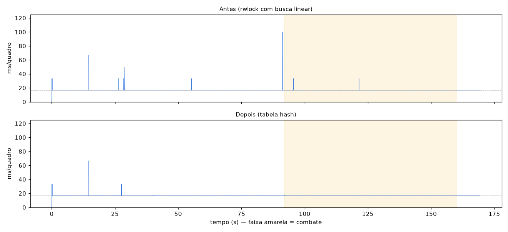

# Fase 2.5 — Loading e picos: leitura de disco medida e rwlock corrigido

**Data:** 2026-11-12
**Itens do roadmap:** 2.5 (loading) e o restante da 2.2 (picos).

---

## Resumo

| | Antes | Depois |
|---|---|---|
| Quadros > 40 ms em ~170 s | 3–4 (até **117 ms**) | **1** (início do vídeo de abertura) |
| Quadros > 20 ms | 12 | **4** (boot e vídeo) |
| Pior quadro no combate | 33,3 ms | **16,8 ms** |
| Quadros acima de 17 ms no combate | 3–7 | **0** de 4.079 |
| FPS no combate | 59,95 | **60,00** |

**Causa encontrada:** os picos não vinham do disco. Vinham da implementação de **rwlock** (trava de leitura/escrita) herdada do bbport:
- o jogo cria **131 mil** rwlocks na rota de teste, com ~1.700 vivos ao mesmo tempo;
- a cada *lock* e *unlock*, o runtime percorria a **lista inteira** de rwlocks, sob um **mutex global** compartilhado por todas as threads.

Ao surgir uma onda de 100 inimigos, a thread `Enemy_AsyncSetup` e as 4 threads de job do jogo ficavam se esperando nesse mutex. O laço principal travava por 100 ms.

---

## 2.5 Leitura de arquivos (medida)

Criei o `KR_IO_TRACE=1` em `runtime_file.c`. Ele mostra:
- cada leitura de 1 ms ou mais, com as fases separadas: preparo das *traps* da GPU, syscall e anotações depois;
- um resumo por segundo;
- cada arquivo aberto, com o tempo.

Resultado na rota completa (boot → menus → missão → 70 s de combate):

| Medida | Valor |
|---|---|
| Total lido | **108,6 MB** em 3.446 leituras |
| Tempo total em syscalls de leitura | **13,8 ms** (na sessão inteira) |
| Pior segundo | 40,6 MB, 5,1 ms de syscall |
| Leituras ≥ 1 ms | **nenhuma** |
| Carga da missão | só abre arquivos `.at9` pequenos (vozes e efeitos). Os dados grandes já foram carregados no boot. |

**Conclusão:** o disco não é gargalo. Tudo vem do cache de páginas do Linux em microssegundos, e o tempo de loading é o ritmo do próprio jogo. Não há o que otimizar em I/O; mmap ou leitura antecipada não mudariam nada.

---

## 2.2 Como o pico foi achado

1. O log por quadro (`BB_FRAME_LOG`) mostrou o pico de 100 ms em 91,1 s:
   - a GPU estava parada;
   - não houve compilação de shader;
   - no quadro seguinte os draws saltam de 280 para 1.457 (o exército aparecendo).
2. O amostrador `KR_STALL_PROFILE=1` mostrou o que as threads faziam depois da criação de `Enemy_AsyncSetup`:
   - a thread `Enemy_AsyncSetup` passava a maior parte do tempo voltando de `scePthreadRwlockWrlock` / `scePthreadRwlockUnlock` (eboot `0x268b07`, `0x268b92`);
   - `runTaskMain` e as `TaskJobThread_1..4` esperavam em `sceKernelWaitEventFlag` (`0x268871`).
3. Em `runtime_rwlock.c`, todo lock, unlock e destroy fazia `find_locked`, que percorria a lista de todos os rwlocks segurando um único `pthread_mutex`.

### A correção (`port/src/runtime_rwlock.c`, marcada com `kr-port`)
- O registro virou uma **tabela hash** de 16.384 posições, com busca O(1).
- O registro passou a ser protegido por um **`pthread_rwlock`**. As buscas usam leitura, então threads diferentes não se bloqueiam.
- Cada rwlock ganhou um **mutex próprio** para os dados de dono e pendências, no lugar do mutex global.
  - Esse mutex é tomado antes de soltar o registro, então um `destroy` não consegue liberar um rwlock enquanto alguém o usa.
- A semântica PS4 não mudou: os códigos de erro (`EDEADLK`, `EPERM`, `EBUSY`…), a criação por inicializador estático e o *handle* inválido depois de `destroy` continuam iguais.
- O log mostra a contagem: `Runtime: rwlocks: N created, M live` (em 1024, 2048, …).

### Validação
- Duas execuções seguidas (`rw1`, `rw2`) deram resultados idênticos: 60,00 FPS no combate, 0 quadros acima de 17 ms no combate e 1 quadro acima de 40 ms na rota toda.
- Nenhum erro de rwlock em nenhuma das duas.

---

## O que sobra

- **Início do vídeo de abertura (67 ms, um quadro):** é o AvPlayer abrindo o vídeo. Acontece uma vez, numa tela preta, e não vale o risco de mexer agora.
- **Boot:** dois quadros de 33 ms antes do primeiro logo.

---

## Arquivos alterados neste passo

- `port/src/runtime_rwlock.c`: registro em tabela hash, lock por rwlock e contagem de rwlocks no log.
- `port/src/runtime_file.c`: `KR_IO_TRACE` (leituras lentas, resumo por segundo e arquivos abertos).
- Logs: `out/bench/io1..3.log`, `stall2.log`, `rw1.log`, `rw2.log`, mais os `.frames` e `.json`.

## Próximos passos sugeridos

1. **2.7 Resolução** 1440p/4K, já que a GPU fica ~92% ociosa.
2. **2.6 Áudio:** medir o custo do mixer por bloco de 256 amostras.
3. Unwind de exceções C++ (as 5 funções que faltam).
